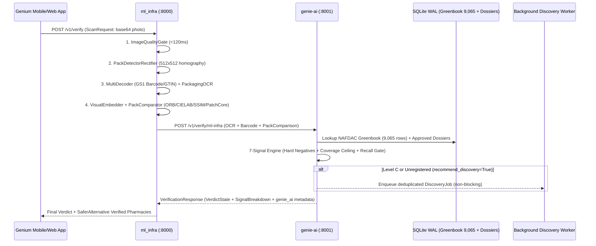

# GENIE AI & ML Infra — Part 3: System Interlink Architecture & Hackathon Judge Q&A Playbook

> **Purpose:** Shows exactly how `ml_infra` and `genie-ai` connect at runtime (code & HTTP contracts), plus crisp, technically grounded answers to the toughest questions hackathon judges will ask.

---

## 1. How `ml_infra` and `genie-ai` Interlink

The two services have clean, non-overlapping responsibilities and communicate over HTTP (controlled by `GENIE_AI_URL` in `ml_infra`) or in-process via shared adapters:

### Exact Interlink Files & Functions

| Direction | File | Function / Endpoint | What It Does |
| --- | --- | --- | --- |
| **`ml_infra` → `genie-ai` (Verification)** | `ml_infra/src/genie/verification/pipeline.py` | `VerificationPipeline.verify_scan()` (Step 7c) | Packages `ocr_data`, `barcode_res`, `resolved` metadata, and `PackComparator` results (`element_checks`, `flagged_grid_zones`, `inconsistencies`, `anomaly_score`) and calls `GenieAIClient.verify_ml_infra_payload()`. Falls back cleanly to local fusion if `GENIE_AI_URL` is unset or unreachable. |
| **`ml_infra` HTTP Client** | `ml_infra/src/genie/integrations/genie_ai_client.py` | `GenieAIClient` (`verify_ml_infra_payload`, `trigger_discovery`, `get_discovery_job`, `list_products`) | Async `httpx` client configured via `settings.GENIE_AI_URL` and `settings.GENIE_AI_TIMEOUT_SECONDS` (`ml_infra/src/genie/common/config.py`). |
| **`genie-ai` Bridge Endpoint** | `genie-ai/api/main.py` | `POST /v1/verify/ml-infra` (`post_verify_ml_infra`) | Receives `MLInfraVerifyPayload`, translates via `scan_input_from_ml_infra()`, runs `GenieOrchestrator.verify_scan()`, and returns `to_ml_infra_response()`. |
| **Schema & Signal Translator** | `genie-ai/verification/adapters/ml_infra_adapter.py` | `scan_input_from_ml_infra()`, `to_ml_infra_response()`, `MLInfraPackComparatorAdapter` | Maps `PackComparisonResult` anomalies into `VisualMatchInput`, merges barcode/OCR/VLM fields, and converts GENIE's 6-state verdict to `ml_infra`'s 3-state `VerdictState` (`Consistent with genuine` / `Suspicious` / `Cannot verify`). |
| **`ml_infra` → `genie-ai` (Async Discovery)** | `ml_infra/src/genie/api/v1/discovery.py` | `POST /v1/discovery/jobs`, `GET /v1/discovery/jobs/{job_id}` | Replaces the placeholder stub by forwarding discovery requests to `genie-ai`'s real SQLite WAL job queue (`orchestrator/jobs.py`). |
| **`genie-ai` → `ml_infra` (Reference Sync)** | `ml_infra/src/genie/integrations/genie_ai_client.py` | `sync_genie_ai_dossiers_to_index()` | Reads approved reference images from `genie-ai/data/products/<slug>/product.json` so `ml_infra`'s `ReferencePackIndexer` indexes only human-approved ground truth. |

---

## 2. Hackathon Judge Q&A Playbook (Hard Technical Questions & Defenses)

### Q1: *"Why didn't you just send the photo to GPT-4o / Gemini Vision and ask if the drug is fake?"*
**Answer:**
- Vision LLMs hallucinate regulatory data and cannot reliably judge subtle packaging counterfeits without a **ground-truth reference image** of the Nigerian-market pack.
- Our system separates responsibilities:
  1. **Deterministic computer vision (`PackComparator`)** measures geometric homography (ORB+RANSAC), lighting-normalized CIELAB color delta-E, 4×4 grid SSIM, and patch anomalies against **approved reference images**.
  2. **Deterministic regulatory grounding (`GreenbookStore` + `EvidenceGate`)** checks all 9,065 NAFDAC records, SmPC shelf-life/ingredient specs, GS1 barcode check digits, and NAFDAC Public Alert recalled batches (`562626`).
  3. **Vision LLMs are strictly bounded** to extraction/triage — never the sole decider.

### Q2: *"How do you stop your AI from hallucinating drug specs, GTINs, or recall batches?"*
**Answer:**
- Every LLM-synthesized dossier passes through our deterministic **Evidence Gate** (`genie-ai/validation/evidence.py` → `validate_and_gate_dossier()`):
  - Every `EvidenceClaim` must include a `verbatim_quote` verified by normalized substring match against the actual fetched source text.
  - Any `gtins`, `shelf_life_months`, or `affected_batches` not present in the source bundle (or failing GS1 check-digit validation) are **automatically quarantined/stripped**.
  - Any conflict with Tier 1 NAFDAC Greenbook blocks promotion from `staging` to `approved`.

### Q3: *"Why do you have a manual approval step for reference images instead of 100% autonomous image scraping?"*
**Answer:**
- During live testing, open-web image search returned **seized counterfeit photos from Nigerian news articles** (e.g., WhatsApp seizure photos) and foreign B2B export boxes (`indiamart.com`).
- In pharmaceutical safety, poisoning the visual reference database with even one counterfeit image causes catastrophic false negatives.
- So we built **automated discovery + trust filtering (`trusted_sources` allowlist of 20 verified Nigerian licensed pharmacies & 21 manufacturers) into `staging`**, paired with a lightweight **human approval gate** (`scripts/ingest_references.py`, `scripts/promote_reference.py`) before an image can elevate a product from Level C to Level B/A. That is production-grade ML governance, not a shortcut.

### Q4: *"What happens when a user scans one of the other 9,060 NAFDAC drugs that isn't in your 5 cached demo products?"*
**Answer:**
- **Graceful degradation (no crashes, no fake confidence):**
  - `genie-ai` resolves the drug in **<15ms** against the local 9,065-drug `greenbook.db` (e.g., Kesartem `C4-0143` or Ibumartem `B4-6458`).
  - Because there are no approved reference images yet (**Level C**), the visual signal marks itself `unavailable`, coverage drops, and the verdict honestly caps at **`registered_unverified` (`Cannot verify`)** while still running NAFDAC, expiry/batch, GTIN, and recall checks.
  - Simultaneously, `GenieOrchestrator` enqueues a **non-blocking, deduplicated background discovery job** (`discovery_jobs` SQLite WAL queue) so the system enriches that product asynchronously for future scans.

### Q5: *"What if a counterfeiter copies a real NAFDAC number onto a fake box?"*
**Answer:**
- We explicitly model **`nafdac_derived` vs `independent` signals** (`verification/engine.py`).
- Even if the NAFDAC number (`04-1928`), brand text, GTIN, and an unverified scratch sticker all match, **`nafdac_derived` signals alone can NEVER unlock `authentic` or `likely_authentic`**.
- Only an **`independent`** visual match against approved packaging references or an externally verified security feature (e.g. MAS SMS) can reach `authentic` — and any hard negative (recalled batch, impossible shelf life, visual anomaly) immediately overrides to `Suspicious` / `likely_counterfeit`.

### Q6: *"Why didn't your system flag Coartem (`04-3275`) or Panadol Extra (`04-0005`) as fake when NAFDAC Greenbook lists them as 'Inactive'?"*
**Answer:**
- By auditing all 9,065 rows of `data/greenbook.db`, we discovered that **2,788 products (30.7%)** — including major genuine brands like Coartem, Lonart, and Panadol Extra — have status `'Inactive'` in Greenbook due to pending NAFDAC license renewals, **not** revocations.
- `evaluate_nafdac_signal()` (`verification/signals/nafdac.py`) only triggers a hard negative on explicit `Revoked`/`Suspended`/`Cancelled` statuses and treats `'Inactive'` / `'Ongoing Renewal'` as a neutral limitation note. This prevented massive false positives on legitimate Nigerian medicines.

### Q7: *"How do you handle packaging redesigns so genuine older packs aren't flagged as counterfeit?"*
**Answer:**
- Both `genie-ai` (`packaging_versions` with `edition_id` & `is_primary`) and `ml_infra` (`ProductVersion` + `HistorySignalEvaluator`) support **multi-version packaging history**.
- If a scanned pack matches an approved historical edition (`is_historical_version=True`) and is still within its valid expiry date, it is recognized as a legitimate legacy edition rather than flagged as fake.

### Q8: *"How do you keep latency fast when both CV and web discovery exist?"*
**Answer:**
- **Online path:** `ml_infra` enforces `<120ms` Quality Gate + `<150ms` Barcode Decode + `<4s` total CV budget; `genie-ai`'s local 7-signal verification runs in **10–18ms** over SQLite WAL (`PRAGMA journal_mode=WAL`).
- **Offline/Async path:** Web discovery + SmPC synthesis runs in a bounded background `ThreadPoolExecutor(max_workers=2)` with atomic deduplication in SQLite (`discovery_jobs`), so it **never blocks** a user's scan.

### Q9: *"When you recommend a 'Safer Alternative' pharmacy, how do you know they actually have the drug in stock?"*
**Answer:**
- We strictly separate **`pharmacy_verified`** (licensed Nigerian pharmacy status) from **`stock_confirmed`** (`SaferAlternative` in `ml_infra/src/genie/schemas/verdict.py`). We never claim stock is confirmed unless a real-time inventory feed confirms it.
