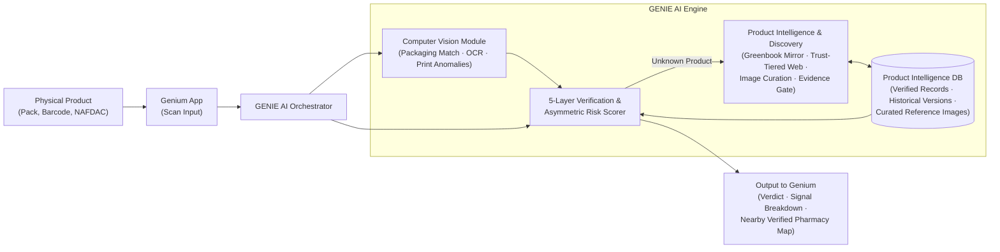

# Genium & GENIE AI — Pitch Deck & Presentation Guide

> Tight 9-slide pitch deck guide structured around **Genium** (consumer platform + verified pharmacy map) and **GENIE AI** (with **Product Intelligence & Discovery** as the centerpiece innovation, backed by Computer Vision and the 5-layer verification stack).

---

## 1. Core Positioning & System Split

### One-Line Elevator Pitch
**Genium** lets consumers scan medicines and consumables at the point of purchase to catch counterfeits and find nearby verified pharmacies—powered by **GENIE AI**, a living product intelligence engine that continuously discovers, validates, and versions what genuine products actually look like.

### Clean 2-Layer Ownership Framing

| Layer | Role in the Pitch | What Lives Here |
| --- | --- | --- |
| **Genium** *(Consumer Platform)* | The shield in the buyer's hand | Product scanning UX, clear authenticity verdicts, counterfeit alerts, and map-based **Verified Pharmacy Discovery** |
| **GENIE AI** *(Intelligence & Verification Engine)* | The living brain & moat | **Product Intelligence & Autonomous Discovery** *(flagship innovation)*, **Computer Vision** packaging inspection, **Source Validation & Versioning**, and **Multi-Layer Verification Scoring** |

---

## 2. Slide-by-Slide Pitch Deck Guide (9 Slides)

---

### Slide 1 — Title
- **Goal:** Land the brand, mission, and Genium × GENIE AI relationship in 10 seconds.
- **Headline:** **Genium — Powered by GENIE AI**
  *Subtitle:* Living Product Intelligence for Counterfeit Detection & Safe Pharmacy Access
- **On-Slide Points:**
  - Verify medicines & consumables before you buy
  - Powered by continuously evolving product intelligence
  - Direct map guidance to nearby verified pharmacies when a pack looks unsafe
- **Visual Idea:** Clean smartphone scan mockup + minimal `Genium` × `GENIE AI` lockup.
- **Speaker Cue (~15s):**
  > "Buying medicine shouldn't be a gamble. Meet **Genium**—a consumer verification platform powered by **GENIE AI**, a living product intelligence engine that knows what genuine products look like and guides people to verified pharmacies when something doesn't match."

---

### Slide 2 — The Problem
- **Goal:** Make the human stakes and everyday buyer helplessness immediately clear.
- **Headline:** **Counterfeits Hide in Plain Sight—and Buyers Are Flying Blind**
- **On-Slide Points:**
  - Counterfeit pharmaceuticals and consumables risk lives and destroy trust in everyday retail
  - Modern fakes mimic genuine logos, colors, and layouts—impossible to verify by eye at the counter
  - Even when a buyer suspects a product is fake, they have no reliable way to know where nearby to buy the real one safely
- **Visual Idea:** Side-by-side medicine carton visual with question marks over the packaging print, NAFDAC code, barcode, and local store shelf.
- **Speaker Cue (~25s):**
  > "At the point of purchase, everyday consumers have almost zero visibility. Sophisticated counterfeits look identical to real packs at a glance, most people can't verify registration or subtle print anomalies on the spot, and even if they walk away suspicious, they still don't know which nearby pharmacy they can trust."

---

### Slide 3 — The Gap (Why Existing Solutions Fall Apart)
- **Goal:** Show why current approaches break in real-world markets like Nigeria.
- **Headline:** **Why Existing Verification Solutions Fall Apart**
- **On-Slide Points:**
  - **Static databases rot:** The moment a manufacturer updates packaging, outdated databases trigger false counterfeit alarms—and new products return "unknown"
  - **Codes get cloned:** Counterfeiters print genuine barcodes (GTINs) and real NAFDAC registration numbers straight onto fake cartons
  - **Vision alone breaks without truth:** Computer vision fails without clean, verified, historically versioned reference photos to compare against
- **Visual Idea:** Three compact failure cards: `Static DB → Goes Stale` · `Codes Only → Easily Cloned` · `Vision Only → No Verified Reference History`.
- **Speaker Cue (~30s):**
  > "Existing tools fail for three reasons. Static databases go stale as soon as a manufacturer changes a box. Barcode or NAFDAC-only apps are easily bypassed because counterfeiters copy real codes onto fake packs. And computer vision on its own falls apart without clean, versioned reference images. The real gap isn't scanning—it's **keeping ground truth alive**."

---

### Slide 4 — Introducing Genium
- **Goal:** Define Genium in one sharp sentence, then show the shift from *finding out too late* to *verifying before you buy*.
- **Headline:** **Introducing Genium: Verify Before You Buy—Not After You Take It**
- **One-Liner (Top of Slide):** **Genium is a point-of-purchase verification platform that helps consumers confirm a product is genuine before they buy it—and find verified pharmacies when it isn't.**
- **What the User Sees:**
  - **Check at the Counter:** Instead of buying a product and discovering it's fake only after using it, Genium lets you verify authenticity right at the point of purchase
  - **Instant, Transparent Verdict:** Snap the pack, barcode, or NAFDAC number to get a clear result (`Authentic`, `Suspicious`, `Likely Counterfeit`, `Unknown`) with a plain-English breakdown
  - **Verified Pharmacy Map:** If a product is flagged unsafe, walk away safely—Genium maps nearby verified pharmacies, explicitly separating **verified pharmacy status** from **confirmed product availability**
- **Visual Idea:** Bold one-liner banner across the top, followed by three crisp mobile screens: `Scan at Counter` → `Verdict & Signal Breakdown` → `Nearby Verified Pharmacies Map`.
- **Speaker Cue (~30s):**
  > "**Genium** is a verification platform that helps consumers confirm a product is real before they buy it—and directs them to verified pharmacies when it isn't. Instead of taking a medicine and finding out too late that it's fake, here's what a user sees: right at the counter, they scan the pack, get a clear multi-signal verdict in seconds, and if anything looks suspicious, Genium maps nearby **verified pharmacies**—keeping *verified pharmacy status* strictly separate from *confirmed stock*."

---

### Slide 5 — GENIE AI (Highlight: Product Intelligence + Supporting 5 Verification Layers)
- **Goal:** Spend **~75% of this slide** on **Product Intelligence & Discovery** (the real innovation) and **~25%** summarizing the **5 verification layers** that consume it.
- **Headline:** **GENIE AI: Self-Updating Product Intelligence + 5-Layer Verification**
- **On-Slide Points:**
  - **Core Innovation — Autonomous Product Intelligence & Discovery:**
    - **Local Regulatory Mirror:** 9,065 official NAFDAC Greenbook drug records (+ direct SmPC PDFs) indexed locally in SQLite + FTS5 for millisecond baseline lookup
    - **Trust-Tiered Multi-Angle Discovery:** Searches regulatory alerts, manufacturers, vetted pharmacies, and packaging changes—ranking Tier 1/2/3 sources and blocking counterfeit-prone marketplaces/social sites
    - **Visual Reference Curation:** Deduplicates packaging photos (`SHA-256` + perceptual `dHash`) and verifies exact product/strength & view angle via multimodal AI before feeding CV
    - **Evidence Grounding & Versioning:** Every extracted claim carries a verbatim source quote; new discoveries land in `staging`, and historical packaging revisions are preserved
  - **Supporting Verification Stack (5 Layers Powered by Genie's Intelligence):**
    - `1. Computer Vision` *(packaging & print anomaly comparison)* · `2. GTIN / Barcode` *(GS1 check-digit & match)* · `3. NAFDAC Registration` *(Greenbook status + recall alerts)* · `4. Batch & Spec Consistency` · `5. Historical Version Matching` *(no false alarms on older valid packs)*
- **Visual Idea:** Two-zone layout — **top/left 70% bold spotlight box** for the 4-stage **Product Intelligence & Discovery** pipeline; **bottom/right 30% compact pill bar** listing the 5 verification layers feeding asymmetric risk scoring.
- **Speaker Cue (~45s — spend ~35s on Product Intelligence, ~10s on the 5 layers):**
  > "The real innovation under the hood is **GENIE AI's Product Intelligence engine**. Instead of relying on a static catalog or blind LLM prompts, Genie anchors on a local mirror of **9,065 NAFDAC Greenbook records and official SmPC PDFs**, runs trust-tiered multi-angle web discovery while blocking counterfeit-prone marketplaces, curates and deduplicates packaging reference photos with perceptual hashing and multimodal inspection, and requires verbatim source quotes before promoting any record from staging.
  >
  > Once Genie knows what genuine looks like, it powers **five verification layers**—Computer Vision, GTIN/barcode checks, NAFDAC registration & recalls, batch consistency, and historical packaging version matching—so no single cloned code can fool the system."

---

### Slide 6 — Platform & Technical Architecture (End-to-End Flow)
- **Goal:** Show judges the clean data flow from **Product Scan** all the way to **Consumer Output**.
- **Headline:** **End-to-End Architecture: From Product Scan to Verified Output**
- **Visual / Flow Diagram (Core of the Slide):**

- **On-Slide Callouts (3 short bullets under diagram):**
  - **Fast Path:** Known products verify immediately across all 5 layers against cached Greenbook + curated version history
  - **Self-Learning Loop:** Unknown products trigger GENIE's async Product Intelligence pipeline to discover, validate, and stage new dossiers
  - **Safe Fallback:** Suspicious/counterfeit verdicts trigger Genium's Verified Pharmacy Map
- **Speaker Cue (~30s):**
  > "Here's the full flow from product to output. The user scans a pack in **Genium**. **GENIE AI** routes the scan through its Computer Vision module and 5-layer verification engine against our **Product Intelligence Database**—which combines our local NAFDAC Greenbook mirror, curated reference images, and historical packaging versions. If a product is unknown, Genie automatically triggers its discovery pipeline to investigate and stage it. Finally, Genium returns a clear verdict, per-signal breakdown, and—when needed—nearby verified pharmacies on the map."

---

### Slide 7 — Live Demo
- **Goal:** Prove the system works end to end in 60–90 seconds.
- **Headline:** **Live Demo: Genium × GENIE AI in Action**
- **Demo Beats (on slide as minimal cues):**
  - **1. GENIE AI Discovery:** Pass a drug name or NAFDAC code (e.g., `Augmentin 625 mg` / `A4-6238`) → show instant local Greenbook enrichment, official SmPC PDF extraction, trust-tiered filtering, and 100% verbatim-quoted dossier output
  - **2. Genium Scan & Verification:** Show multi-layer verification verdict + signal breakdown (and how historical versions avoid false positives)
  - **3. Safe Fallback:** Show counterfeit alert opening Genium's Verified Pharmacy Map
- **Hackathon Backup Checklist:**
  - Keep `data/greenbook.db` (9,065 records) pre-synced locally for offline-proof lookup.
  - Keep saved run JSONs in `data/runs/` and verified images in `data/images/` ready in case venue Wi-Fi throttles live web calls.
- **Speaker Cue (~10s intro before demo):**
  > "Let's show this working live—starting with GENIE AI autonomously building a source-grounded drug dossier, and then how Genium turns that intelligence into an instant consumer verdict and safe pharmacy map."

---

### Slide 8 — Phased Roadmap
- **Goal:** Show clear focus now and a credible path to scale beyond the hackathon.
- **Headline:** **Phased Roadmap**
- **On-Slide Points:**
  - **Phase 1 — Pharmaceuticals (Now):** NAFDAC-registered drugs, local Greenbook mirror, autonomous product intelligence, 5-layer verification, and Verified Pharmacy Map
  - **Phase 2 — All NAFDAC Consumables:** Expand the same discovery & versioning engine to packaged foods, beverages, and cosmetics + continuous monitoring alerts
  - **Phase 3 — Ecosystem Integrations:** Manufacturer-supplied micro-feature references and live pharmacy POS/inventory confirmations
- **Visual Idea:** Clean 3-stage horizontal arrow (`Phase 1: Drugs & Pharmacies` → `Phase 2: All Consumables & Monitoring` → `Phase 3: Manufacturer & Live Stock Feeds`).
- **Speaker Cue (~20s):**
  > "We're starting with pharmaceuticals because NAFDAC registration and pharmacy discovery solve an urgent safety need today. From there, the exact same GENIE engine scales to all NAFDAC consumables—food, drinks, cosmetics—and eventually direct manufacturer micro-feature feeds and live pharmacy inventory."

---

### Slide 9 — End
- **Goal:** Close with clarity, confidence, and a line judges remember.
- **Headline:** **Genium × GENIE AI**
  *Closing Line:* Knowing What Genuine Looks Like—So Consumers Don't Have To Guess.
- **On-Slide Points:**
  - **GENIE AI:** Living product intelligence, CV, validation, versioning & 5-layer verification
  - **Genium:** Instant consumer scanning & Verified Pharmacy Map
  - QR code / GitHub repo / team names
- **Speaker Cue (~15s):**
  > "In simple terms: **GENIE AI** knows what genuine products should look like and keeps that knowledge alive—powering **Genium** to spot what doesn't match and guide people to safer pharmacies. Thank you."

---

## 3. Judge Q&A Cheat Sheet

### Q1: "What stops a counterfeiter from copying a real barcode and NAFDAC number onto a fake box?"
> "That's why GENIE uses **5-layer asymmetric verification**. A valid barcode or NAFDAC code only confirms a product exists—it never proves authenticity on its own. Combining it with Computer Vision packaging inspection, batch consistency, and recall checks catches cloned codes."

### Q2: "How do you stop GENIE from hallucinating specs or scraping fake drug listings?"
> "Three guardrails: a pre-fetch blocklist drops counterfeit-prone marketplaces and social sites; candidate images go through `SHA-256` + perceptual `dHash` deduplication and multimodal inspection; and every extracted claim requires an exact `source_url` and `verbatim_quote` before leaving `staging`."

### Q3: "What happens when a manufacturer legitimately redesigns its packaging?"
> "GENIE stores **historical packaging versions** (`product_versions`) rather than overwriting one record. Continuous monitoring stages new revisions while keeping older valid versions recognized, preventing false counterfeit alarms on legitimate older stock."

### Q4: "How do you know a nearby pharmacy actually stocks the genuine product?"
> "We strictly separate **pharmacy verification** from **product availability**. A pharmacy is only shown as carrying a specific product when its stock has been explicitly confirmed; otherwise it's displayed strictly as a verified licensed pharmacy."

### Q5: "Why not just use Google Lens or ChatGPT?"
> "General tools lack a local NAFDAC Greenbook baseline, don't maintain versioned packaging history per product, don't enforce verbatim-quote provenance, and don't connect suspicious scans to verified local pharmacies."

---

## 4. Pacing Guide

| Pitch Length | Slides 1–3 (Hook/Problem/Gap) | Slide 4 (Genium) | Slide 5 (GENIE AI Spotlight) | Slide 6 (Architecture) | Slide 7 (Demo) | Slides 8–9 (Roadmap/End) |
| --- | --- | --- | --- | --- | --- | --- |
| **3 Minutes** | `40s` | `20s` | `40s` | `20s` | `45s` | `15s` |
| **5 Minutes** | `65s` | `35s` | `65s` | `35s` | `75s` | `25s` |
