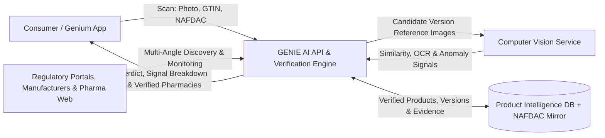

# Genium & GENIE AI — Pitch Deck & Presentation Guide

> Practical slide-by-slide script, architecture visuals, demo plan, and Q&A cheat sheet for presenting **Genium** (the consumer platform) and **GENIE AI** (the product intelligence & verification engine).

---

## 1. Core Positioning & Story Arc

### One-Line Elevator Pitch
**Genium** lets consumers scan consumables at the point of purchase to spot counterfeits and locate nearby verified pharmacies—powered by **GENIE AI**, a living product intelligence engine that continuously discovers, validates, and versions what genuine products actually look like.

### How the Three Pieces Fit Together (Keep This Crystal Clear)

| System Component | Role in the Story | What It Owns |
| --- | --- | --- |
| **Genium** | Consumer-facing shield | Mobile/web product scanning, clear authenticity verdicts, counterfeit alerts, and map-based **Verified Pharmacy Discovery** |
| **GENIE AI** | The living brain & data moat | Regulatory mirroring (NAFDAC Greenbook), multi-angle web discovery, source validation, packaging versioning, reference image curation, multi-layer verification orchestration, and pharmacy verification/stock logic |
| **Computer Vision Model** | Visual inspection specialist | Visual embeddings, packaging comparison against Genie's curated reference images, printing anomaly detection, and OCR extraction |

**Narrative rule for the pitch:** Sell the **user pain and safe outcome through Genium**, then reveal **GENIE AI as the technical breakthrough** that makes Genium trustworthy instead of brittle.

---

## 2. Slide-by-Slide Pitch Deck Guide (10 Slides)

---

### Slide 1 — Title & Hook
- **Goal:** Establish the brand, the mission, and the relationship between Genium and GENIE AI in 10 seconds.
- **Suggested Headline:** **Genium — Powered by GENIE AI**
  *Subtitle:* Living Product Intelligence for Counterfeit Detection & Safe Pharmacy Access
- **On-Slide Bullet Points:**
  - Verify consumables & medicines before you buy
  - Multi-layer authentication powered by continuously updated intelligence
  - Instant fallback to nearby verified pharmacies when a product looks unsafe
- **Visual Idea:** Clean hero mockup of a smartphone scanning a medicine carton next to a subtle three-node badge (`Genium App` ← `GENIE AI` → `CV Engine`).
- **Speaker Cue (~20s):**
  > "When someone buys medicine at a local pharmacy, they shouldn't have to gamble on whether what's in their hand is real. Meet **Genium**—our consumer verification app—powered by **GENIE AI**, a continuously evolving product intelligence engine built to know what genuine products look like and guide people to safer alternatives."

---

### Slide 2 — The Problem
- **Goal:** Make the human stakes and everyday buyer helplessness immediately relatable.
- **Suggested Headline:** **Counterfeits Hide in Plain Sight—and Buyers Have Zero Visibility**
- **On-Slide Bullet Points:**
  - Counterfeit pharmaceuticals and consumables endanger lives and erode trust in everyday retail
  - Packaging looks convincing to the naked eye; consumers can't verify registration, batch consistency, or subtle print changes at the counter
  - Even when a product seems suspicious, buyers have no easy way to find a trusted alternative nearby
- **Visual Idea:** Split graphic showing a real vs. suspect medicine box side by side with question marks over the NAFDAC number, barcode, print quality, and pharmacy shelf.
- **Speaker Cue (~25s):**
  > "For everyday consumers, spotting a fake medicine or consumable at the point of purchase is nearly impossible. Fake packaging copies real logos, and most buyers don't know how to check a NAFDAC code or spot a subtle packaging shift. Worse—if you suspect a pack is fake, you're still stuck wondering where nearby you can actually buy the real one safely."

---

### Slide 3 — Why Existing Solutions Fall Short
- **Goal:** Explain why static databases, barcode-only apps, and naive AI/CV wrappers break in the real world.
- **Suggested Headline:** **Static Databases & Single-Signal Checks Fail in the Real World**
- **On-Slide Bullet Points:**
  - **Static databases rot fast:** Legitimate packaging redesigns get falsely flagged as counterfeit; newly launched products come back "unknown"
  - **Codes alone get cloned:** Counterfeiters copy genuine barcodes (GTINs) and real NAFDAC registration numbers straight onto fake cartons
  - **Vision alone isn't enough:** A CV model is only as reliable as the reference images it compares against—bad lighting, missing history, or unverified web photos break visual checks
- **Visual Idea:** Three "broken shield" cards: `Static DB (Outdated)` · `Barcode/ID Only (Cloned)` · `Vision Only (No Version History)`.
- **Speaker Cue (~30s):**
  > "Most verification tools rely on one fragile check. Static databases go stale the moment a manufacturer updates its box, triggering false alarms. Checking only a barcode or NAFDAC number fails when counterfeiters print real registration numbers onto fake packs. And computer vision alone collapses without clean, historically versioned reference images. Counterfeit detection isn't a one-signal problem—it's a living intelligence problem."

---

### Slide 4 — Introducing Genium (The Consumer Experience)
- **Goal:** Show the clean end-to-end user experience in Genium before diving under the hood.
- **Suggested Headline:** **From Scan to Safe Choice in Seconds**
- **On-Slide Bullet Points:**
  - **1. Scan & Check:** User scans packaging, barcode, or NAFDAC number in Genium
  - **2. Clear Multi-Signal Verdict:** Translates complex checks into an easy verdict (`Authentic`, `Suspicious`, `Likely Counterfeit`, `Unknown`) with transparent reasoning
  - **3. Verified Pharmacy Discovery:** When a product is flagged unsafe, Genium maps nearby verified pharmacies—explicitly separating **verified pharmacy status** from **confirmed product stock**
- **Visual Idea:** Three clean phone screens side by side: `Camera Scan` → `Authenticity Breakdown Card` → `Nearby Verified Pharmacies Map (Verified Badge vs. Confirmed Stock Badge)`.
- **Speaker Cue (~30s):**
  > "Here's what the user sees in **Genium**. They scan a drug pack, get a clear verdict backed by multiple independent checks—not a mysterious yes/no—and if anything looks suspicious or recalled, Genium immediately opens a map of nearby **verified pharmacies**. Crucially, we separate *whether a pharmacy is verified* from *whether stock is confirmed*, so we never mislead a consumer about availability."

---

### Slide 5 — Platform Architecture (Genium ↔ GENIE AI ↔ CV Model)
- **Goal:** Show clean engineering boundaries and why the architecture scales.
- **Suggested Headline:** **Modular Architecture Built Around Living Intelligence**
- **On-Slide Bullet Points:**
  - **Genium** owns the consumer scan UX, counterfeit alerts, and map discovery
  - **GENIE AI** owns autonomous web/regulatory acquisition, evidence validation, historical versioning, curated reference image storage, and multi-layer decision scoring
  - **CV Model** plugs in through a strict contract—receiving Genie's curated packaging versions and returning similarity, OCR, and visual anomaly signals
- **Visual / Diagram Idea:** Place this clean flow diagram directly on the slide:

- **Speaker Cue (~25s):**
  > "Architecturally, we separated concerns cleanly. **Genium** handles the consumer interface. Our **CV service** focuses purely on visual similarity, OCR, and print anomalies. Everything in the middle is **GENIE AI**—our intelligence, verification, and knowledge layer that acquires reference truth, versions packaging over time, and combines every signal into one decision."

---

### Slide 6 — The Innovation: GENIE AI (Autonomous Product Intelligence & Discovery)
- **Goal:** Spotlight the core technical innovation you built—this is where technical judges lean in.
- **Suggested Headline:** **GENIE AI: Turning the Open Web & Regulatory Data into Grounded Product Truth**
- **On-Slide Bullet Points:**
  - **Local Regulatory Baseline:** Mirrored **9,065** official NAFDAC Greenbook drug records into SQLite + FTS5 (plus direct SmPC PDF links) for millisecond baseline lookups
  - **Parallel Multi-Angle Discovery & Trust Tiering:** Expands a drug hint into targeted queries (*regulatory alerts, manufacturer leaflets/SmPCs, pharma references, packaging changes*), scores sources into **Tier 1 / Tier 2 / Tier 3**, and blocks counterfeit-prone marketplaces & social sites
  - **Two-Stage Visual Curation Funnel:** SSRF-safe download + `SHA-256` & pure-Pillow perceptual `dHash` deduplication → single-call multimodal Gemini check to filter out logos or wrong strengths (`375 mg` vs. `625 mg`) before passing clean photos to CV
  - **Evidence Grounding & Staging Gate:** Every extracted AI claim requires a cited `source_url` and `verbatim_quote`, keeping unverified discoveries in `staging` until deterministically checked
- **Visual Idea:** A 4-step left-to-right pipeline strip showing: `1. Seed ("Augmentin 625" / NAFDAC ID)` → `2. 9,065-Record Greenbook + 5 Parallel Search Angles (Tiered & Blocklisted)` → `3. Dedup + Multimodal Packaging Filter` → `4. Grounded Product Dossier (Approved vs. Staging)`.
- **Speaker Cue (~40s):**
  > "This is the heart of the innovation. When GENIE encounters a product—even from just a NAFDAC code or brand name—it doesn't blindly prompt an LLM. First, it hits our local mirror of **9,065 NAFDAC Greenbook records** in milliseconds to enrich ingredients, strength, manufacturer, and official SmPC PDFs. Then it runs parallel multi-angle searches, filters out high-risk social and classifieds sites, and ranks Tier 1 regulatory and manufacturer sources first. Candidate images go through exact `SHA-256` and perceptual `dHash` deduplication followed by multimodal inspection so logos or wrong dosages never reach the CV model. And every extracted claim must carry a verbatim quote from its source."

---

### Slide 7 — Multi-Layer Verification & Product Versioning
- **Goal:** Show how Genie turns intelligence into smarter, lower-false-positive scan verdicts.
- **Suggested Headline:** **Five Independent Signals + Historical Packaging Memory**
- **On-Slide Bullet Points:**
  - **5 Verification Layers:** Visual packaging comparison · Barcode/GTIN check-digit & match · NAFDAC registration & recall alert check · Batch/product consistency · Historical packaging version match
  - **Asymmetric Risk Scoring:** A valid cloned barcode barely boosts confidence; a mismatched NAFDAC registration, expired license, or severe print anomaly triggers a strong alert
  - **Product Intelligence Versioning:** Tracks historical packaging revisions separately from current ones so legitimate redesigns aren't flagged as fake
  - **Continuous Monitoring:** Watches tracked sources & regulatory notices to detect recalls or packaging transitions early
- **Visual Idea:** A "Verification Scorecard" mockup next to a mini product timeline (`v1 2022 Pack` → `v2 2025 Pack (Hologram Added)`), showing both marked valid rather than overwriting history.
- **Speaker Cue (~30s):**
  > "At scan time, GENIE runs five independent checks with asymmetric scoring: because counterfeiters copy real barcodes, a matching GTIN isn't treated as proof—but a NAFDAC mismatch or recall notice immediately drives risk up. And because GENIE preserves historical packaging versions instead of overwriting old photos, a consumer holding a legitimate previous-edition pack isn't hit with a false counterfeit scare."

---

### Slide 8 — Live Demo Choreography (60–90 Seconds)
- **Goal:** Prove it's real engineering, not slideware, in under 90 seconds.
- **Suggested Headline:** **Live System Walkthrough**
- **On-Slide Bullet Points:**
  - **Beat 1 — Consumer Flow (Genium):** Scan a product → inspect multi-signal breakdown → view nearby verified pharmacies on counterfeit alert
  - **Beat 2 — Autonomous Intelligence (GENIE AI):** Feed a drug name or NAFDAC code (e.g., `A4-6238` or `Augmentin 625 mg`) → watch instant Greenbook enrichment, multi-angle trust-ranked sources, and curated packaging dossier output
  - **Beat 3 — Versioning & Provenance:** Show how historical versions and verbatim-quote evidence claims protect database integrity
- **Visual Idea:** Live screen share / terminal + UI split (or crisp recorded fallback clip ready on Slide 8).
- **Speaker Cue (~15s intro before switching screens):**
  > "Let's show this working live—first from a consumer's perspective in Genium, and then under the hood inside GENIE AI's discovery pipeline."

> **Hackathon Demo Checklist (Do Before Pitching):**
> - Keep `data/greenbook.db` (9,065 records) pre-synced locally so Greenbook lookups work even if venue Wi-Fi drops.
> - Save 2 pre-run `DiscoveryBundle` + `CandidateProductDossier` JSON outputs and verified images in `data/` as an instant fallback if DuckDuckGo rate-limits on shared conference Wi-Fi.
> - Show one clear JSON/UI view highlighting: `trust_tier`, `verbatim_quote`, `sha256`/`dhash`, and `view_type`.

---

### Slide 9 — Defensibility & Phased Roadmap
- **Goal:** Convince judges why this wins beyond the hackathon weekend.
- **Suggested Headline:** **The Moat Is Verified, Versioned Intelligence—Built to Expand**
- **On-Slide Bullet Points:**
  - **Defensibility:** Anyone can call a vision API; very few have a trust-tiered, evidence-grounded, historically versioned registry of authentic consumables
  - **Phase 1 (Now):** NAFDAC-regulated pharmaceuticals + Verified Pharmacy Discovery
  - **Phase 2:** Expand across all NAFDAC-regulated consumables (packaged foods, beverages, cosmetics)
  - **Phase 3:** Direct manufacturer micro-feature verification feeds & live pharmacy POS/inventory confirmations
- **Visual Idea:** Three-step horizontal roadmap arrow (`Phase 1: Drugs & Pharmacies` → `Phase 2: All Consumables` → `Phase 3: Manufacturer & Live POS Feeds`).
- **Speaker Cue (~25s):**
  > "Our long-term moat isn't a single prompt or a static scraper—it's a self-updating, evidence-verified graph of genuine products and their packaging history. Starting with pharmaceuticals where NAFDAC registration and pharmacy discovery create immediate urgency, the same engine extends naturally to packaged foods, cosmetics, and direct manufacturer security feeds."

---

### Slide 10 — Team & Closing
- **Goal:** End on clarity, ownership, and a memorable takeaway line.
- **Suggested Headline:** **GENIE AI × Genium**
  *Tagline:* Knowing What Genuine Looks Like—So Consumers Don't Have To Guess.
- **On-Slide Bullet Points:**
  - **Genium:** Consumer scanning experience & map discovery
  - **GENIE AI:** Product intelligence, regulatory mirroring, evidence validation, versioning & verification orchestration
  - **CV Engine:** Packaging similarity, OCR & anomaly detection
- **Visual Idea:** Clean closing slide with project name, QR code / repo link, and one bold closing quote.
- **Speaker Cue (~15s):**
  > "In simple terms: **GENIE** knows what genuine products should look like, keeps that knowledge updated, and powers **Genium's** ability to spot what doesn't match—and safely guide people to where real products are sold. Thank you."

---

## 3. Judge Q&A Cheat Sheet

### Q1: "What stops a counterfeiter from just printing a real barcode and NAFDAC number onto a fake box?"
> "That's exactly why we built **multi-layer asymmetric verification**. A valid barcode or NAFDAC number alone only provides baseline existence—it never proves a pack is authentic. GENIE pairs regulatory and GS1 check-digit lookups with CV packaging inspection, batch/spec consistency, and live recall checks, so a mismatch on any visual or registration layer still flags the product."

### Q2: "If GENIE scrapes the open web, how do you stop it from scraping fake listings or letting an LLM hallucinate product specs?"
> "Three guardrails. First, we enforce a domain blocklist before fetching—high-risk classifieds and social marketplaces never enter the pipeline—and rank Tier 1 regulatory/manufacturer sources above general web sites. Second, candidate photos go through perceptual `dHash` deduplication and multimodal inspection to reject logos or wrong dosages. Third, every extracted claim requires an exact `source_url` and `verbatim_quote`, and new discoveries land in `staging` until deterministically verified."

### Q3: "What happens when a genuine manufacturer redesigns their packaging?"
> "GENIE models products with **explicit version history** (`product_versions`) rather than one mutable record. Continuous monitoring detects packaging updates via content and image hash diffs and stages a new version while preserving older legitimate editions—so Genium recognizes valid legacy stock instead of causing false counterfeit panic."

### Q4: "How do you know a nearby pharmacy actually has the real product in stock?"
> "We treat **pharmacy verification** and **inventory confirmation** as strictly separate data checks. In Phase 1, Genium surfaces licensed, verified pharmacies nearby; a pharmacy is only labeled as carrying a specific product when its availability has been explicitly confirmed via partner or inventory updates."

### Q5: "Why not just ask ChatGPT or Google Lens to check the box?"
> "General-purpose tools don't hold a persistent, trust-tiered Nigerian NAFDAC baseline, don't maintain historical packaging versions per product, don't verify every extracted number against verbatim source quotes, and don't connect a suspicious scan to verified local pharmacies."

### Q6: "How does GENIE hand reference images to the Computer Vision model without tightly coupling them?"
> "GENIE intentionally does **not** generate image vectors, because embeddings belong to whichever vision architecture the CV team trains or upgrades. GENIE curates, deduplicates, angle-tags, and stores verified reference binaries and metadata, then hands clean reference image sets to the CV service over a clean API contract."

---

## 4. Pacing & Slide Design Tips

### Time Splits
- **3-Minute Hackathon Pitch:**
  - Slides 1–3 (Problem & Why Now): `45s`
  - Slides 4–5 (Genium + Architecture): `40s`
  - Slides 6–7 (GENIE AI Innovation & Multi-Layer Verification): `50s`
  - Slide 8 (Demo): `35s`
  - Slides 9–10 (Moat & Close): `10s`
- **5-Minute Pitch:**
  - Expand Slide 6 (walk through a concrete example like `A4-6238` or `Augmentin 625 mg`) and give the Live Demo a full `75–90s`.

### Visual & Delivery Rules
1. **Max 3–4 short bullets per slide:** Put details in your spoken cues, not on the projector.
2. **Show real artifacts:** Screenshots/cards of an actual Greenbook record, a rejected vs. kept packaging image check, and a multi-signal verdict card beat generic stock icons every time.
3. **Keep terminology crisp:** Refer to **Genium** when speaking from the buyer's perspective, and **GENIE AI** when speaking about data discovery, validation, versioning, and decisioning.
